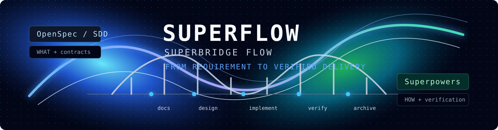

<p align="center">
  
</p>

<p align="center">
  <a href="https://www.npmjs.com/package/@chenmk/superflow"></a>
  <a href="https://www.npmjs.com/package/@chenmk/superflow"></a>
  <a href="https://www.npmjs.com/package/@chenmk/superflow"></a>
  <a href="https://github.com/BasketballNotFound-ManKun/superflow-cli/stargazers"></a>
  <a href="./LICENSE"></a>
  
</p>

<p align="center">
  <strong>One entry for requirements, implementation, and verification in Claude Code or Codex.</strong>
</p>

<p align="center">
  <a href="./README.zh-CN.md">中文文档</a> ·
  <a href="#quickstart">Quickstart</a> ·
  <a href="#everyday-examples">Examples</a> ·
  <a href="#upgrade-and-troubleshoot">Upgrade & troubleshooting</a> ·
  <a href="./INSTALL.en.md">Installation guide</a>
</p>

# Superflow

Superflow (SuperBridge Flow) connects requirements, source changes, tests, and independent review in a recoverable development workflow.
Describe your goal; it chooses the next step from your project and existing progress, and asks when a requirement or permission needs your decision.

**For everyday use, remember one entry: `/superflow` in Claude Code or `$superflow` in Codex.**
The router selects phase skills as needed. You can start without learning OpenSpec, SDD, or internal skill names.

## Quickstart

Have **Node.js 20+, Git**, and an installed, signed-in Claude Code or Codex ready.
Hooks require Bash and Python3; on Windows, use Git Bash or an equivalent shell.
Requirements and document work can start in one tool; **dual-Agent managed development requires both CLIs to be installed and authenticated**.
Superflow uses your existing model accounts and permissions. Model usage is billed by the respective platforms.

### Install

Install the CLI in your system terminal:

```bash
npm install -g @chenmk/superflow@latest --registry https://registry.npmjs.org
```

Enter the **root of the project** you want to work on and choose one set of commands.
`init` deploys skills, Hooks, and project context; `mcp install` registers managed work:

**Claude Code:**

```bash
superflow init --agent claude --scope global --language en --yes
superflow mcp install --agent claude
```

**Codex:**

```bash
superflow init --agent codex --scope global --language en --yes
superflow mcp install --agent codex
```

For both tools, use `--agent both` in both commands.
Global tool assets can be reused across projects; initialization also creates the current project's OpenSpec and context directories.
See [INSTALL.en.md](./INSTALL.en.md) for installation options, source installation, and Windows guidance.

### Restart and check

**Restart the selected Claude Code / Codex tool after setup** to load the skills and MCP.
Then check from your system terminal, for example:

```bash
superflow --version
superflow doctor --agent claude --scope global
# Use codex for Codex, or both to check both tools.
```

Resolve failed checks using the remediation shown by `doctor`.

### Start your first task

Type in your tool's **conversation**, with the project open:

| Tool | Where to type | Entry |
| --- | --- | --- |
| Claude Code | Claude Code conversation in the project | `/superflow` |
| Codex | Codex conversation with the project open | `$superflow` |

Start with a read-only task to get familiar with the flow:

**Claude Code:**

```text
/superflow Explain this project's main modules and call relationships. Do not change code yet.
```

**Codex:**

```text
$superflow Explain this project's main modules and call relationships. Do not change code yet.
```

Then describe your real task, including relevant document paths, symptoms, or expected outcomes.

## Everyday examples

These examples use Claude Code. In Codex, replace the prefix with `$superflow`.

| Goal | Example request |
| --- | --- |
| Clarify requirements | `/superflow Analyze docs/requirements.md, confirm scope and open decisions, and stop before implementation.` |
| Build a feature | `/superflow Add CSV export to the order list. Inspect existing code, agree on the approach, then implement and verify.` |
| Fix a problem | `/superflow Clearing the search filters does not restore the list. Reproduce, investigate, fix, and verify.` |
| Use managed delivery | `/superflow Complete this requirement in managed mode, independently review the implementation, and repair findings.` |
| Continue existing work | `/superflow Continue openspec/changes/order-export/ from its current unfinished tasks.` |
| Check delivery | `/superflow Compare this implementation with the requirements and test evidence, and list unfinished work.` |
| Prepare archive | `/superflow Check whether the current change is ready to archive, and summarize verification and remaining work.` |

Replace example document and directory paths with your actual paths. State scope limits directly, such as “discussion only”, “documents only”, or “do not change code yet”.
For continuation, provide the existing change directory or implementation prompt so the workflow can inspect its state and handoff.

## What happens next

```text
Describe a goal → Inspect project and requirements → Agree on design → Implement and verify → Independently review and repair → Report results
```

- **Clear, bounded work:** select the applicable flow based on risk.
- **Complex or disputed requirements:** investigate source and documents, then ask for decisions that affect implementation.
- **Document-only requests:** complete documents and review without starting managed implementation.
- **Dual-Agent managed work:** the current host supervises and reviews; the peer implements and verifies.
- **Delivery:** summarize changes, evidence, remaining risks, or external blockers. Commits, pushes, and releases require your explicit authorization.

After interruption or conversation compaction, use the same entry to continue; persisted state guides recovery.

## Upgrade and troubleshoot

From your project root, select `claude`, `codex`, or `both` as appropriate:

```bash
superflow update --with-package --agent claude --scope global --language en
```

This entry upgrades the CLI, dependencies, and host assets together. **Restart the selected tool after upgrading, then run `superflow doctor` with the matching `--agent`.**

| Situation | Next step |
| --- | --- |
| `/superflow` or `$superflow` is missing | Check that `init` targeted the intended tool, then restart it. |
| MCP is missing or its runtime is stale | Run `superflow mcp install --agent <tool>` or the update command, then restart. |
| The CLI still reports an old version | Inspect PATH with `which -a superflow` (`where superflow` on Windows) and identify the new entry. |
| Managed work cannot start with only one tool | Install and authenticate the peer CLI; requirements and documents can still start in the available tool. |
| A database, device, or external permission is required | Provide the test resource or decide how to handle the reported gap. |
| You switched projects | Reuse global assets; run `init` in the new project root when project directories and context are needed. |
| You used 0.5.x skill names | Use the unified entry from 0.6.0. Updates back up and retire recognized old assets while preserving custom content for review. |

Read more: [installation guide](./INSTALL.en.md) · [managed delivery](./docs/managed-delivery-loop.en.md) ·
[release history](https://github.com/BasketballNotFound-ManKun/superflow-cli/releases).

<details>
<summary>Advanced reference: workflow, gates, terminal-managed work, and maintenance commands</summary>

## Why SuperBridge Flow

Modern agentic coding often fails in the gap between a well-written spec and
real verified delivery. SuperBridge Flow makes that gap explicit:

- OpenSpec/SDD owns **WHAT**: requirements, API contracts, database and field
  semantics, tests, real-entry acceptance, and quality gates.
- Superpowers owns source-level **HOW**: technical design, TDD order,
  worktree/team execution, review, and verification discipline.
- Handoff files, phase state, hooks, and guards reduce context drift when long
  conversations get compacted or split across agent sessions.

The CLI installs skills, hooks or command aliases, rules, scripts, handoff
state, and dependency guards for Claude Code and Codex.

In OpenSpec/SDD Java repositories, hooks also block unsafe MyBatis `${}`
interpolation, Git hook bypasses, and staged secrets. Java/build edits are
accumulated and compiled once at Stop for affected Maven/Gradle modules. Missing
build tools or compilation failures are reported as failed verification.
Native session observation hooks warn once on the sixth edit to one file in
ten minutes or the third consecutive failure of one tool in five minutes. A
successful call resets that tool's failure count, and SessionEnd clears the
observation state. These warnings do not block tools or alter managed budgets.
`superflow context-audit` provides a read-only check for `CONTEXT.md`
terminology and required ADR fields. A missing ADR is advisory and does not add
an approval gate.
`superflow docs-audit` reports Markdown age, dead code anchors, and inbound
links. New Markdown placement reminders always exit successfully and never move,
merge, or delete files.
`superflow map-audit` compares full, task Top-K, and directory/symbol skeleton
contexts from the existing Understand Anything graph without creating another
persistent map.
`superflow cleanup-audit` reports duplicate names, complexity clues, and TODO
hotspots with evidence and a route, without modifying source files.
`superflow hook-migrate --path <project> --json` audits project Hooks read-only;
`--apply` backs up the config and removes only known legacy ake Hooks with
provenance or managed Superflow/SDD entries. Custom Hooks remain. Project init
and update use the same migration; the global prompt Hook also attempts one
safe migration per project session and asks for a restart if definitions changed.
Use `superflow hook-audit --scope global --agent both --json` to inspect old
relative global Hooks, or run `superflow hook-migrate --scope global --agent
both --apply` separately. A normal global npm postinstall, `superflow init`,
resumed init, and update run the same allowlisted migration. They back up host
configs before editing, preserve unknown and custom Hooks, and leave files
untouched on repeated runs. `superflow doctor` fails with a remediation command
if a known old global registration remains. `init/update --no-hooks` skips their Hook steps;
npm `--ignore-scripts` skips postinstall. Restart the host session after migration.

## Highlights

0.5.10 strengthens document delivery: requirement × real-entry coverage (including
exclusions), real-entry test contracts, and content-bound Coding Ready receipts.
Existing document receipts need [coverage migration and re-review](assets/skills-en/superflow/references/document-review-coverage.md)
before new dispatch or source edits. Semantic correctness remains an Agent review responsibility.

- **Dual-Agent managed delivery.** The current host Agent reviews directly while
  the peer Agent develops, starts, and verifies in one CLI session without a
  tool-turn limit, then actively returns one structured result. A later session
  is created only for review repair, process failure, or human recovery. Review
  and execution default to 5 reviews, 7 executor calls, and 12 total calls.
  Durable journals allow recovery after terminal or network
  interruption, and passing work stops for explicit Git approval.
- **Checks for common delivery gaps.** Phase checks and independent review examine missed requirements, missing consumers, SQL drift, and Mock-only evidence.
- **Architecture 6-questions before cross-service code.** Any change crossing
  service / SDK / MQ / device / callback / gateway boundaries must answer six
  questions in the technical design: who owns the module, what is the call
  direction, where are existing entry/exit points, are new ones allowed, which
  paths are forbidden, what is the evidence anchor.
- **Field And Status Reverse Impact matrix.** Every schema / status / enum
  change must enumerate its write sites, read sites, filter conditions,
  derived / sync sites, cross-module consumers, and test coverage — including
  reverse-recovery scenarios (down then up again, deleted then re-created, old
  value unavailable while upstream didn't send the field).
- **6 productized lessons as gates, not reminders.** Full-impact discovery,
  business semantics over HTTP 200, no default fallbacks, DB reconciliation,
  real-entry evidence, code-data verification — each baked into a specific
  phase and a specific hook. Missing evidence blocks the next phase.
- **5 phases × 5+ guard scripts as hard gates.** `superflow-guard.sh` +
  `superflow-hook-guard.sh` + `superflow-contract-hooks.sh` +
  `superflow-sql-sync-hook.py` + `superflow-test-report-lint.py` +
  `superflow-verify-integration.sh`. No handoff hash → no implementation. No
  real-entry evidence → no "verified" report.
- **Context-drift proof via handoff + state + sha256.** When long sessions
  compress, when agents switch, when multiple workers parallelize —
  `.sdd/handoff/sdd-context.{md,json}` + sha256 + `.sdd/state.yaml` keep
  Worker / Tester / Reviewer on the same source of truth. Stale prompts
  blocked by hash mismatch.
- **One entry across the workflow.** `/superflow` or `$superflow` selects clarification, contracts, design, implementation, verification, and archive from the task and current state, then applies the relevant checks.
- **`superflow check` audits delivery readiness by level.** `files` checks the
  required set, `docs` adds every-prompt links, independent reviews, and complex
  diagrams, while `coding-ready` adds environment preflight plus the complete
  docs/design/implement gates and writes a receipt bound to the current handoff hash.
- **`superflow config` tunes review depth per change.** `--review-mode
off|standard|thorough` controls code-review intensity; `--auto-transition`
  controls automatic phase progression. Match the rigor to the risk.
- **Startup version check.** Every superflow command silently compares your
  installed version against the npm registry. A new version triggers a
  non-blocking upgrade hint on stderr.

## Managed delivery: a bounded review loop


Give Superflow a straightforward development task or a frozen Superflow / SDD
contract. The peer Agent implements and verifies; the current Host reviews the
workspace, gates, and evidence.

```text
Task or frozen contract
          ↓
Peer Agent builds and verifies
          ↓
Current Host reviews source, gates, and evidence
     ├─ needs_fix → findings + prior evidence → Peer Agent ↺
     └─ pass → delivery-ready state → waits for your Git / release approval
```

The loop is deliberately bounded, not an unattended agent swarm:

- The Host owns semantic review; the peer owns source changes and verification.
- A failed review returns precise findings and durable evidence, so the peer
  repairs the current workspace instead of restarting from a blank prompt.
- Default budgets cap the work at 5 Host reviews, 7 peer invocations, and 12
  total Agent calls. Journals make interruption recovery auditable.
- A pass means the frozen delivery contract is satisfied. It never means an
  absolute risk guarantee, and it never auto-commits, pushes, deploys, or
  writes to production.

Read the [managed delivery loop guide](./docs/managed-delivery-loop.en.md) for
the role boundary, transition rules, and recovery behavior.

## Workflow

```text
docs -> design -> implement -> verify -> archive
```

Each phase has a clear owner and an exit gate:

| Phase       | Owner                          | Output                                            |
| ----------- | ------------------------------ | ------------------------------------------------- |
| `docs`      | OpenSpec/SDD                   | Requirements, contracts, API/DB/test docs         |
| `design`    | Superpowers                    | Source-level technical design and TDD plan        |
| `implement` | Superpowers + SuperBridge Flow | Batched implementation prompts and review gates   |
| `verify`    | Current Host + deterministic gates | Implementation review, test reports, and real-entry evidence |
| `archive`   | OpenSpec/SDD                   | Final spec archive and lifecycle closure          |

## Advanced: manage tasks from the terminal

Manage an implementation prompt, OpenSpec change, or direct development task:

```bash
superflow pipeline "<prompt path, change directory, or task>" --managed \
  --project "<project root>" --supervisor current --executor peer
```

For a prompt path or SDD change, also pass a Host-authored frozen acceptance
contract. Its JSON declares business invariants, existing repository-relative
source coverage, deliverables, verification, and exclusions; start fails closed
without it.

```bash
superflow pipeline "<prompt path or change directory>" --managed \
  --project "<project root>" --acceptance-contract ./acceptance-contract.json \
  --supervisor current --executor peer
```

The selected language is frozen into the task contract and reused by Agent
prompts, reviews, journals, reports, notifications, and resumed rounds.
The first executor invocation runs continuously without a Superflow tool-turn
limit, while the current host agent reviews directly instead of the service
spawning a nested copy. The first invocation receives the frozen task prompt;
later repair or recovery invocations receive a condensed handoff so a new
session can continue from the workspace, pending tasks, and complete review
findings. When the
task reports `external_supervisor_review_required`, submit the review and resume:

```bash
superflow pipeline --resume-task <task-id> --submit-host-review <review.json>
```

### Interact from the current host Agent (recommended MCP path)

Register the bundled local stdio MCP server for Codex or Claude:

```bash
superflow mcp install --agent both
```

After restarting the host Agent session, keep talking to the current Codex or
Claude Agent. The host uses MCP to supervise while Superflow starts only the
peer executor:

- `superflow_managed_start` freezes the task and always uses `external_host`.
- `superflow_managed_status` and `superflow_managed_list` expose state and evidence.
- `superflow_managed_wait` defaults to a 240-second compatible transport window;
  Hosts with longer tool limits may explicitly request up to twelve hours. Window
  expiry continues compactly from `latestSequence`. Active requests expose healthy
  progress through standard MCP notifications, while two checkpoints without an
  effective milestone return for semantic attention.
- `superflow_managed_message` carries user guidance to the current execution
  boundary or the next handoff.
- `superflow_managed_authorize_executor` freezes task-scoped repository consent without bypassing host DLP.
- `superflow_managed_pause` and `superflow_managed_resume` interrupt the active executor, persist pause, and resume from state.
- `superflow_managed_submit_review` submits one complete structured host review.
- `superflow_managed_record_validation` records environment/release evidence and recomputes three-stage delivery.

Claude Executors receive neither `--max-turns` nor `--max-budget-usd`, so normal
work is not split by a fixed tool-step count or an inaccurate provider-dollar
estimate. The defaults stop a process after 60 minutes with no output or a
two-hour single-invocation deadline. Repeated provider failures,
token/invocation budgets, safety boundaries, and user pause still stop
execution. Safe Java, Maven, Node, and npm executable paths found during
preflight are written into the executor policy to avoid redundant environment
discovery.
To prevent a 1M context window from multiplying input tokens across hundreds of
tool turns, Claude Executors default to early auto-compaction at 70 percent of a
200K effective window. Explicit Claude environment settings win, and the frozen
prompt plus handoff are reloaded after compaction.

MCP mode never starts a nested supervisor CLI. Host conversation and review do
not consume the background Agent invocation budget; only real executor calls do.
Passing delivery enters `environment_validation_blocked`, `local_delivery_ready`,
or `release_ready` according to three-track progress, without automatic commit,
push, deployment, or production writes.

Managed work uses three default circuit breakers: the same mechanical delivery
error receives only one automatic repair, no more than two automatic repairs run
before escalation to the current host, and the next executor call is stopped at
two million cumulative token units. Dollar pricing is not comparable across
model providers, so the default contract has no USD circuit and Claude receives
no `--max-budget-usd`. Three or more permission denials in one invocation also
suppress another executor retry. The Runner derives changedFiles, baseline task
evidence, and verification categories from the real workspace and commands
instead of spending full executor rounds repairing JSON.

Inspect or remove the integration with:

```bash
superflow mcp status --agent both
superflow mcp remove --agent both
```

MCP is the communication channel between the host Agent and the local managed
state machine, not a third model. Host data-disclosure policy for an external
executor provider remains separate from local filesystem access.
An existing task prompt uses a full contract, a direct engineering request gets a
standard execution contract, and even a one-line request receives a minimal
implementation and verification plan before the executor starts.

Design and field evidence:

- [Cross-Agent Managed Work implementation plan](docs/cross-agent-development-implementation-plan.en.md)
- [Managed Work design principles](docs/managed-work-design-principles.en.md)
- [Managed Agent protocol](docs/managed-agent-protocol.en.md)

## What Init Installs

`superflow init` installs and configures:

- OpenSpec CLI, then runs `openspec init <project> --tools ...`
- Superpowers for the selected agent tools. Codex uses the official
  current `superpowers@openai-curated-remote` plugin, discovering versions from native inventory and checking
  `verification-before-completion`, `requesting-code-review`, and
  `finishing-a-development-branch`.
- Superflow skills under the unified superflow namespace
- hooks, scripts, and anti-drift rules
- Codex prompt aliases
- optional understand-anything integration checks
- `docs/sdd-context/` project context scaffolding

OpenSpec and Superpowers are hard dependencies. understand-anything is
best-effort and does not block initialization.

## Commands

| Command                                                      | Purpose                                                                  |
| ------------------------------------------------------------ | ------------------------------------------------------------------------ |
| `superflow init`                                             | Install and configure SuperBridge Flow interactively                     |
| `superflow update`                                           | Refresh installed skills, hooks, scripts, and rules                      |
| `superflow update --with-package`                            | Also update `@chenmk/superflow`, OpenSpec, and Superpowers               |
| `superflow doctor`                                           | Diagnose CLIs, MCP runtime paths, installed assets, and project state     |
| `superflow status`                                           | Show active changes, current phase, next command, and risks              |
| `superflow --language en --help`                             | Show English CLI help                                                    |
| `superflow scan --language en`                               | Regenerate project context templates in English                          |
| `superflow pipeline`                                         | Check pipeline skill deployment                                          |
| `superflow quick "<task>" --path <file> --seam <existing-file>` | Gate a small code task before Quick Spec approval and quick managed execution |
| `superflow pipeline "<task>" --managed --project <path>`     | Run short-session execution with direct review by the current host agent |
| `--acceptance-contract <file>`                                | Required frozen acceptance JSON for prompt/SDD starts                    |
| `superflow docs [change]`                                    | Run the docs gate and check the phase skill                              |
| `superflow design`                                           | Check design-phase skill deployment                                      |
| `superflow implement [change]`                               | Create a current Coding Ready receipt before implementation              |
| `superflow verify`                                           | Check verify-phase skill deployment                                      |
| `superflow archive`                                          | Check archive-phase skill deployment                                     |
| `superflow check <change> --level files\|docs\|coding-ready` | Audit file, document-delivery, or coding readiness                       |
| `superflow config <change> --review-mode <mode>`             | Set review depth (off/standard/thorough)                                 |
| `superflow config <change> --auto-transition <bool>`         | Toggle automatic phase progression                                       |
| `superflow status`                                           | List active changes with phase, tasks, and doc gaps                      |
| `superflow eval <taskPath> [--json]`                         | Evaluate managed quality, calls, tokens, cache, and time offline         |
| `superflow update --with-package`                            | Update superflow, OpenSpec, and Superpowers                              |

## Automatic Update Checks

After hooks are registered, SuperBridge Flow checks core dependency updates once
per new session and throttles real network checks to once every 6 hours by
default.

Default behavior is **check only**. It reports available updates but does not
install them. Run this to update explicitly:

The default check queries npm versions; Superpowers receives a refresh reminder.
Manual update or `apply` refreshes plugins through native commands. To update only
OpenSpec, Superpowers and host assets, use `superflow update --agent codex --scope global --with-dependencies`.

```bash
superflow update --with-package
```

Environment controls:

```bash
# Default: check and report
export SUPERFLOW_AUTO_UPDATE=check

# Disable automatic checks
export SUPERFLOW_AUTO_UPDATE=0

# Optional: update packages, Skills, Hooks, rules, scripts, and managed MCP
export SUPERFLOW_AUTO_UPDATE=apply

# Minimum check interval in seconds; default is 21600
export SUPERFLOW_UPDATE_MIN_INTERVAL_SECONDS=21600
```

`apply` resolves the newly installed CLI from the npm root, avoiding stale PATH shims,
then lets that runtime update OpenSpec/Superpowers and refresh all
detected Agent assets plus managed MCP registrations. A partial failure keeps its
log and removes the throttle stamp so the next session can retry. Restart the
Agent after success because an existing MCP process cannot hot-load the upgrade.

## Language Support

SuperBridge Flow supports English and Chinese installation modes.

- `--language en`: deploys English-facing SuperBridge Flow skills and CLI
  prompts where available.
- `--language zh`: deploys the original Chinese full-detail skill set.

Both language sets follow the same workflow contracts. Choose the language
that fits your team.

## Requirements

- Node.js 20+
- Claude Code or Codex
- npm access to install OpenSpec and Superpowers
- Git Bash or a compatible shell on Windows for hook scripts

On Windows, managed work resolves Agent `.exe/.cmd/.bat` shims and stops the
complete Agent process tree on pause or timeout. macOS/Linux keep detached
process groups; none of the three Agent launch paths concatenates commands in a
general-purpose shell.


</details>

## Star History

The chart is generated by Star History from public GitHub star data. It may stay
empty while the repository is private.

[](https://star-history.com/#basketballnotfound-mankun/superflow-cli&Date)

[Open the Star History chart](https://star-history.com/#basketballnotfound-mankun/superflow-cli&Date)

## License

MIT
